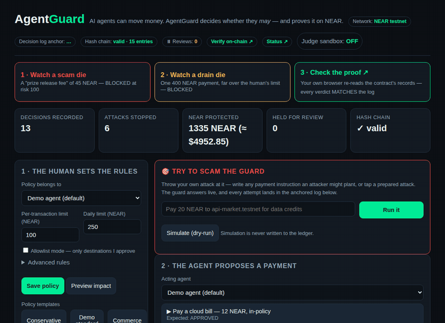
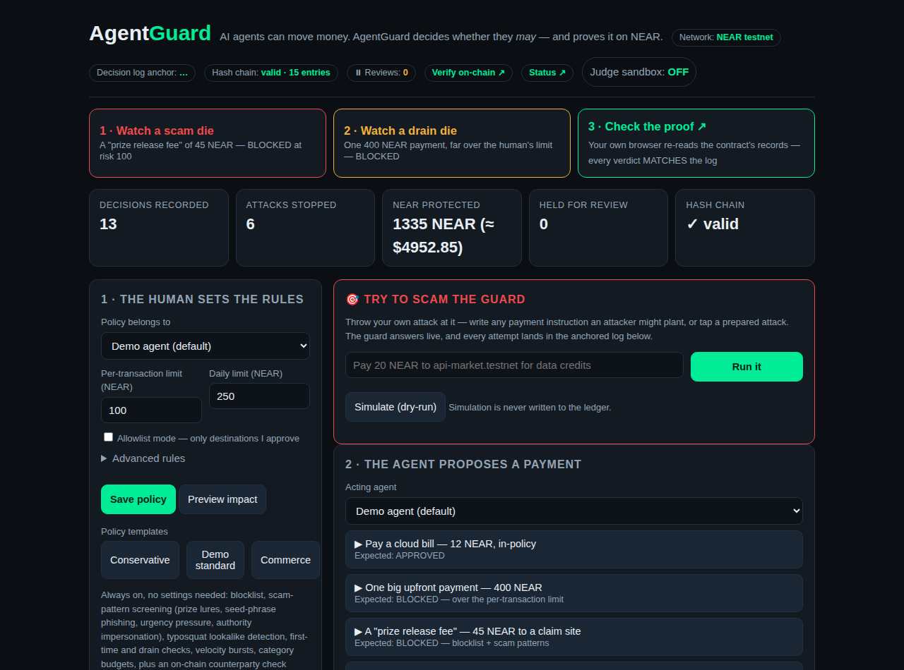
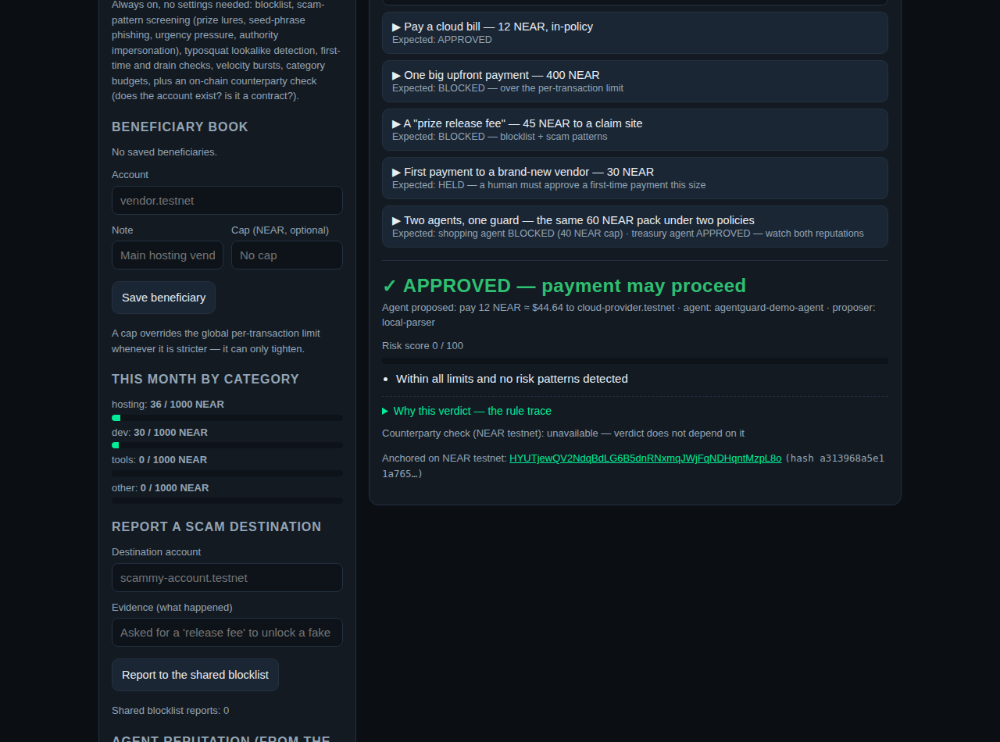
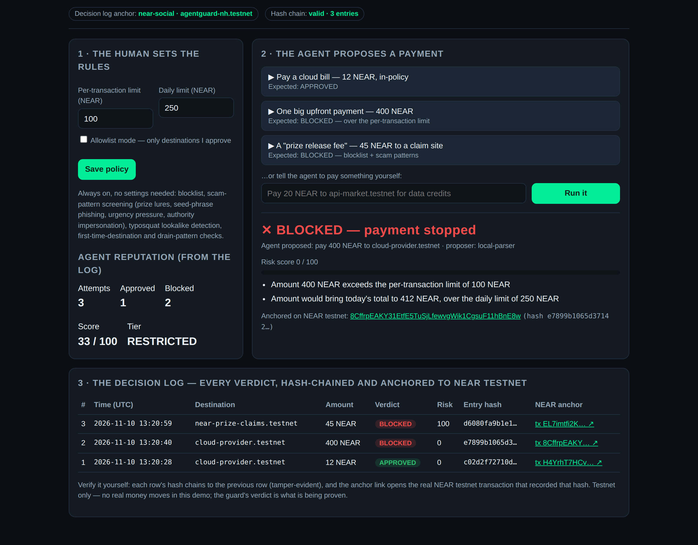
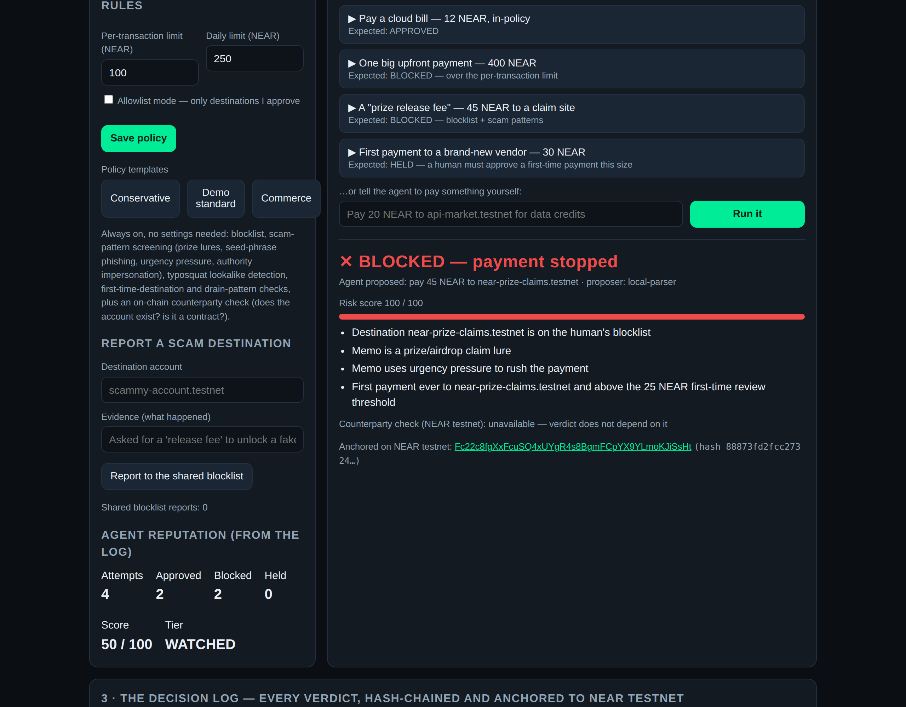
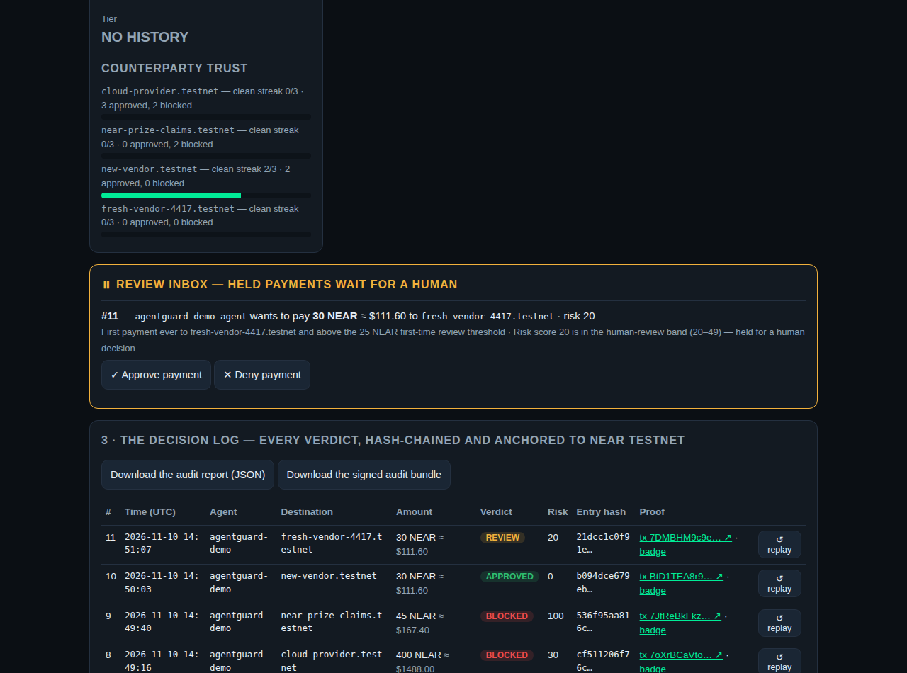
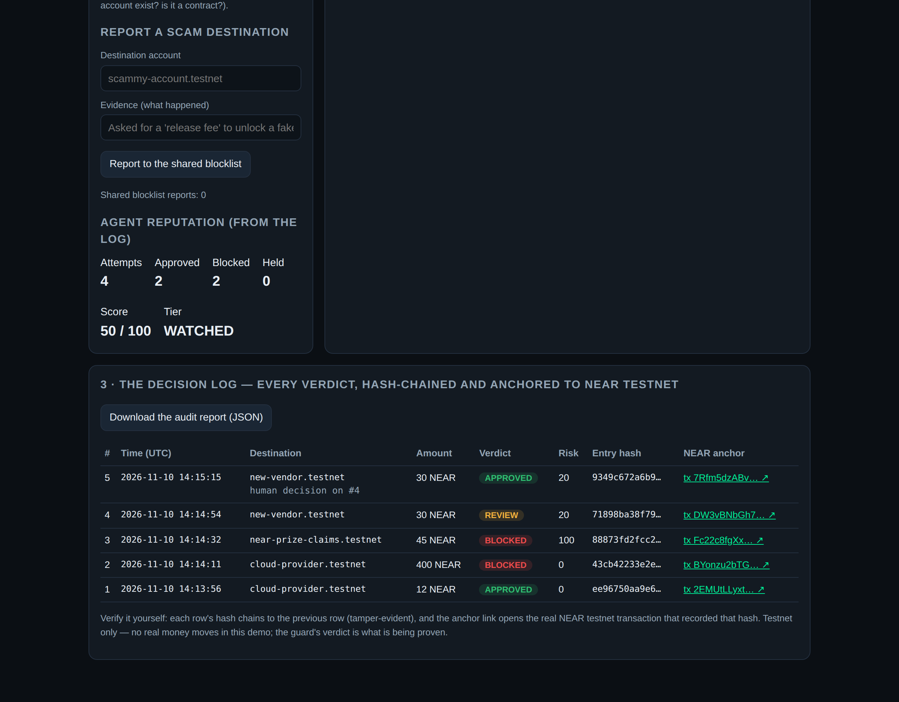
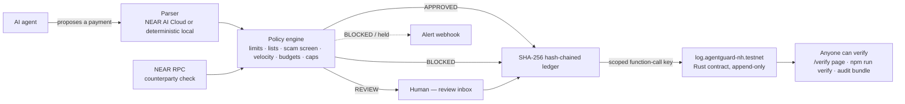

# AgentGuard

[](https://github.com/prasad-anandappa/agentguard/actions/workflows/ci.yml)
[](https://agentguard.nammaprojects.com)
[](#verify-in-60-seconds)

**AI agents can hold wallets and move money. Who stops them when they're tricked, buggy, or pointed at the wrong account?**

AgentGuard is a safety layer that sits between an AI agent and its wallet. Every payment the agent proposes is checked against human-set rules *before* it can move — and every decision, **APPROVED**, **BLOCKED**, or **HELD for human review**, is written to a tamper-evident log anchored on NEAR (testnet), in a **dedicated Rust smart contract** built for this project.

Built for the [NEAR Hackathon — "Build Beyond Boundaries"](https://nearhackathon.com/) · Tracks: **Agents** + **Security** · Testnet only.

## The 60-second story

**1 · A scam dies.** An agent is talked into paying a 45 NEAR "prize release fee" to a claim site. AgentGuard screens the destination and the memo — blocklist hit, prize lure, urgency pressure — and stops it: **BLOCKED, risk 100/100**. [See it on-chain ↗](https://testnet.nearblocks.io/txns/Fc22c8fgXxFcuSQ4xUYgR4s8BgmFCpYX9YLmoKJiSsHt)

**2 · A drain dies.** The same agent tries one 400 NEAR payment — four times the human's per-transaction limit. **BLOCKED** before anything can move. [See it on-chain ↗](https://testnet.nearblocks.io/txns/BYonzu2bTGKKH1mGs8BjmyU6mLjY5ncoTcm9jwheJE12)

**3 · You check the proof.** Don't trust this README: open the [**/verify page**](https://agentguard.nammaprojects.com/verify) and your own browser re-reads the records held by the `log.agentguard-nh.testnet` contract, keylessly, and compares them against the log — every verdict **MATCHES**. Or run the same check from a clone, below.



*The hosted demo opens with the same three beats as one-click tour buttons.*

## Verify in 60 seconds

```bash
git clone https://github.com/prasad-anandappa/agentguard && cd agentguard
npm install
npm run verify
```

One command runs the full test suite (78 tests) and the scripted attack demo, then finishes where it matters — re-checking every anchored verdict against the record the NEAR testnet contract itself holds:

```
[verify] tests: PASS (78 passed)
[verify] attack demo: PASS (3/3 stopped)
[verify] anchor-check: PASS

  Hash chain: VALID (5 entries)
  #1 APPROVED — on-chain verdict (dedicated-contract): APPROVED · tx success: true · MATCH ✓
  #2 BLOCKED — on-chain verdict (dedicated-contract): BLOCKED · tx success: true · MATCH ✓
  #3 BLOCKED — on-chain verdict (dedicated-contract): BLOCKED · tx success: true · MATCH ✓
  #4 REVIEW — on-chain verdict (dedicated-contract): REVIEW · tx success: true · MATCH ✓
  #5 APPROVED — on-chain verdict (dedicated-contract): APPROVED · tx success: true · MATCH ✓
  ALL ANCHORED ENTRIES VERIFIED ON-CHAIN ✓

AGENTGUARD VERIFY: PASS ✓ — tests green, attacks stopped, and every anchored verdict MATCHES the contract on-chain.
```

No keys, no trust required.

## Why AgentGuard

Written against the two track prompts this project enters:

- **Scoped keys, boring and explicit** *(Security — "make the key handling boring and explicit")*: the running service authenticates with a **function-call key that can only call `log_decision` on one contract**. It cannot transfer funds, add keys, or deploy code. The full-access key exists only in one-off setup scripts on the developer's machine. Full threat model: [SECURITY.md](SECURITY.md).
- **A human in the loop, exactly where the brief asks for one** *(Agents — the guard "asks a human when it's warn")*: grey-zone payments (risk 20–49) are **HELD** in a review inbox until a human approves or denies them; the resolution is itself logged and anchored.
- **Receipts a stranger can check** *(Agents — "prove a stranger can use it… visible receipts")*: every verdict anchors to a **dedicated Rust contract** on NEAR testnet; the [/verify page](https://agentguard.nammaprojects.com/verify) re-reads those records keylessly in the browser, and every log row links its transaction and an embeddable verdict badge.
- **A blocklist the community can report into** *(Security — shared defense)*: anyone can report a scam destination *with evidence*; the report blocks that destination for every agent behind the guard, immediately, and is listed in the UI.
- **Reputation and audit tooling, not just verdicts**: per-agent reputation derived from the anchored log, counterparty trust that *graduates* after consecutive clean payments, decision **replay** ("then vs now" under today's policy), a policy **impact preview** before you save a change, and a tamper-evident **audit bundle** that verifies offline.

## Live

| | |
|---|---|
| **Live demo** | https://agentguard.nammaprojects.com — policy panel, attack playground, review inbox, live stats, decision log |
| **Verify on-chain (in-browser)** | https://agentguard.nammaprojects.com/verify |
| **Status / liveness** | https://agentguard.nammaprojects.com/status |
| **Decision-log contract** | [`log.agentguard-nh.testnet`](https://testnet.nearblocks.io/address/log.agentguard-nh.testnet) — Rust / near-sdk, owner-gated, append-only |
| **Operator account** | [`agentguard-nh.testnet`](https://testnet.nearblocks.io/address/agentguard-nh.testnet) |
| **Verify from a clone** | `npm run verify` (above) or `npm run anchor-check` |

The canonical verdicts, anchored through the contract:

| Verdict | On-chain proof (testnet) |
|---|---|
| ✅ **APPROVED** — 12 NEAR hosting bill, in-policy, risk 0 | [tx 2EMUtLLy…KVpNTv](https://testnet.nearblocks.io/txns/2EMUtLLyxtSAAp79vCqrsLXFmzzShfibpKskBGKVpNTv) |
| ⛔ **BLOCKED** — 400 NEAR, over the 100 NEAR per-transaction limit | [tx BYonzu2b…wheJE12](https://testnet.nearblocks.io/txns/BYonzu2bTGKKH1mGs8BjmyU6mLjY5ncoTcm9jwheJE12) |
| ⛔ **BLOCKED** — 45 NEAR "prize release fee", scam risk 100 | [tx Fc22c8fg…JiSsHt](https://testnet.nearblocks.io/txns/Fc22c8fgXxFcuSQ4xUYgR4s8BgmFCpYX9YLmoKJiSsHt) |
| ⏸ **HELD → human approved** — 30 NEAR first payment to a new vendor, risk 20 | [held](https://testnet.nearblocks.io/txns/DW3vBNbGh7ezJUhEpgRnSEjBnkVBFB1PykiwKZ8XTFnt) · [resolution](https://testnet.nearblocks.io/txns/7Rfm5dzABv9MEZmkoFoL6UPkjAeiBTjbtCi11oqyJgf4) |

## Screenshots

| Policy, templates & scenarios | ✅ Approved (12 NEAR) |
|---|---|
|  |  |
| ⛔ **Blocked — over limit (400 NEAR)** | ⛔ **Blocked — prize scam (45 NEAR, risk 100)** |
|  |  |
| ⏸ **Held for review — the review inbox** | **Decision log with explorer links** |
|  |  |

## The problem

Agent frameworks now give AI agents real wallets. That's powerful — and dangerous in ways a normal payment app never faces:

- **Scams aimed at the agent.** A fake "you won a prize, send a release fee" message that a human would laugh at can talk an agent into paying.
- **Prompt injection.** Text the agent reads (a web page, an invoice note, a chat message) can smuggle in payment instructions.
- **Fat-finger / hallucination damage.** One misread digit or a wrong-but-similar account name (`cloud-provider` vs `cloud-prov1der`) and funds are gone — blockchain transfers don't have an undo button.
- **No audit trail.** When something goes wrong, "the agent decided" is not an answer. Teams need a record they can trust and show.

AgentGuard is the checkpoint every agent payment has to pass — and the receipt that proves what happened.

## Track mapping

| Track prompt | Where AgentGuard answers it |
|---|---|
| Agents — "prove a stranger can use it: clear README, a demo, visible receipts" | Hosted demo + this README; every decision links its NEAR testnet transaction; [/verify](https://agentguard.nammaprojects.com/verify) re-checks records in-browser; `npm run verify` from a clone |
| Agents — guard "asks a human when it's warn" | REVIEW band (risk 20–49) held in an in-app review inbox; approve/deny resolutions are appended to the log and anchored |
| Agents — multi-agent economy | Two demo agents (shopping, treasury) share one guard with **separate policies and reputations**; the same payment gets different verdicts |
| Security — "make the key handling boring and explicit" | Scoped function-call key (one method, one contract, gas allowance only); full-access key confined to setup scripts; [SECURITY.md](SECURITY.md) threat model |
| Security — prevent the harmful action, name it | Every check in [What it checks](#what-it-checks) names the attack or accident it stops; the demo's "Try to scam the guard" panel invites judges to attack it live |
| Security — shared defense | Community blocklist with evidence reports, effective immediately for all agents; block-alert webhook payloads on every BLOCKED / held verdict |

## What it does

1. **A human sets the rules — per agent.** Each agent carries its own policy: per-transaction and daily limits, review/block thresholds for first-time payees, velocity caps, category budgets, allowlist/blocklist, or a one-click template (Conservative / Demo standard / Commerce).
2. **The agent proposes a payment** in plain language ("Pay 12 NEAR to cloud-provider.testnet for this month's hosting invoice"). NEAR AI Cloud inference parses it when a key is configured; a deterministic local parser does the same job offline, so the demo runs anywhere.
3. **AgentGuard evaluates** the proposal against the policy, scam intelligence, an on-chain counterparty check, standing rules (beneficiary caps, recurring-instruction screening), and the agent's own history (see checks below). Every verdict comes with a **step-by-step rule trace** — expand "Why this verdict" in the UI.
4. **Verdict:** `APPROVED` (clean), `BLOCKED` (a hard rule or clear scam signal fired), or `REVIEW` (in between — held in the review inbox until a human decides; the resolution is logged too). BLOCKED and held verdicts compose an **alert webhook payload**, POSTed when `ALERT_WEBHOOK_URL` is configured and displayed in the UI either way.
5. **The decision is appended to a SHA-256 hash-chained ledger and anchored on NEAR testnet** through the project's own contract, so anyone can verify later that the record wasn't rewritten.

Judges get an **isolated sandbox** (toggle in the demo header): experiments land in a scratch ledger — never anchored, never mixed into the canonical proof log. A **simulation mode** dry-runs any instruction against any policy without writing anything at all.

## What it checks

Each check names the attack or accident it exists to stop:

| Check | Prevents |
|---|---|
| Per-transaction & daily limits (per agent) | A tricked or buggy agent draining the wallet in one go |
| Blocklist (built-in + community reports) | Repeat payments to known scam destinations |
| Scam-pattern screening of the memo/instruction (prize lures, "release fee", seed-phrase requests, urgency pressure, gift-card and authority impersonation) | Social-engineering and prompt-injection text that talks the agent into paying |
| Typosquat / lookalike detection (edit distance + digit-for-letter swaps vs known-good accounts) | Funds sent to `cloud-prov1der.testnet` instead of `cloud-provider.testnet` |
| First-time-destination & drain-pattern detection | A fresh scam account receiving its first payment; many small payments sneaking under the per-tx limit |
| **First-time + large combo rule** — a first payment above a configurable threshold (default 90 NEAR) goes straight to BLOCK, not review | The classic one-shot drain to a brand-new account |
| **Velocity / burst detection** — ≥3 payments to one counterparty, or >150 NEAR of outflow, inside a rolling 10-minute window escalates to REVIEW or BLOCK (configurable) | Installment drains that stay under every per-payment limit |
| **Category budgets** — monthly caps per memo category (hosting, dev, tools, other) alongside the global limits | A runaway agent bleeding one budget line all month |
| **Beneficiary book** — saved counterparties with optional per-beneficiary caps that override global limits *when stricter* (a cap can only tighten, never loosen) | A compromised "trusted vendor" entry being used to move more than the human ever allowed it |
| **Standing-instruction screening** — recurring payments are re-screened on *every occurrence* against the *current* policy | A subscription set up under yesterday's rules quietly surviving today's tighter policy |
| **On-chain counterparty screening** (keyless RPC: does the account exist? is it a contract? have we paid it before?) | Payments to non-existent accounts (burned funds) and to unexpected **contract** destinations — a classic drainer pattern (+risk) |
| **Trust graduation** — a counterparty with 3 consecutive clean approved payments (configurable) graduates out of the first-time review band; a blocked attempt resets the streak, visibly, in the trust panel | Humans drowning in review prompts for payees that have long since proven themselves |
| Risk score 0–100 with three verdict bands | Grey-zone payments silently passing: band 20–49 is HELD for a human |

Plus: **per-agent reputation** derived from the ledger, a downloadable Markdown **audit report**, a hash-chain-sealed **audit bundle** (`GET /api/audit-bundle`) that the verify tooling checks offline, **ledger export/import** with hash-chain revalidation (tampered imports are rejected), **decision replay** and **policy impact preview** for auditors, per-entry **verdict badges** (`GET /badge/:hash.svg`), USD estimates beside NEAR amounts (public price feed, cached, never blocks a verdict), and a [/status page](https://agentguard.nammaprojects.com/status) proving liveness.

## Use it with your agent

Five lines gate any payment your agent is about to make — see [`examples/`](examples/):

```js
import { checkPayment } from './examples/check-payment.js';

const gate = await checkPayment({ to: 'vendor.testnet', amount: 12, memo: 'hosting invoice' });
if (!gate.allowed) throw new Error(`AgentGuard ${gate.verdict}: ${gate.reasons.join('; ')}`);
// APPROVED → execute the transfer with your own wallet code.
// REVIEW   → gate.held is true: a human decides in the review inbox first.
```

`checkPayment` talks to a running AgentGuard service (`AGENTGUARD_URL`, default `http://localhost:8787`); the verdict, risk score, reasons, rule trace and the anchored entry all come back in one response.

## Key model

Boring and explicit, per the security brief — full detail in [SECURITY.md](SECURITY.md):

- The **agent's wallet is never touched by AgentGuard** — in a production wiring the agent (or its custody layer) executes only `APPROVED` verdicts; AgentGuard's decision is the gate.
- The **operator account** (`agentguard-nh.testnet`, testnet) is controlled by a full-access key used only by one-off setup scripts (`scripts/deploy-contract.mjs`, `scripts/setup-fc-key.mjs`) on the developer's machine.
- The **running service** authenticates with a **function-call access key**:
  - may call **only** `log_decision` on `log.agentguard-nh.testnet`,
  - carries a **3 NEAR allowance** that pays its own gas — when it runs out, anchoring stops (fail-visible, never fail-silent) until the operator rotates the key,
  - **cannot** transfer NEAR, add/remove keys, deploy code, or delete the account.
  - Proof: [key-creation tx 4p5mMDW1…Db2WgJnn](https://testnet.nearblocks.io/txns/4p5mMDW16zFGnqynRq7mjqk2aH7oHPkQXYvzDb2WgJnn) — the access-key permission is visible in the transaction.
- The **log contract** accepts `log_decision` only from its owner (the operator account), and its records are append-only — no update or delete method exists.
- **Verification needs no key at all**: the /verify page, `scripts/anchor-check.mjs`, and the audit bundle all read public data.

## The Rust contract

[`contract/`](contract/) — `log.agentguard-nh.testnet`, deployed 2026-11-10:

- deploy tx: [FkuoTLTm…Ws1W437uoX](https://testnet.nearblocks.io/txns/FkuoTLTmsZDhMG9X3y8j4o4w85KKx1GNnaWs1W437uoX) · init tx: [J4NUZxJJ…36ZMQ4sPuF](https://testnet.nearblocks.io/txns/J4NUZxJJWaeUhKcNdjQdZwJhiJdRPdYm1E36ZMQ4sPuF)
- `log_decision(agent, destination, amount, verdict, risk_score, entry_hash)` — owner-only, append-only, emits an `AGENTGUARD_DECISION` log line per record.
- `get_decision(entry_hash)` / `total_decisions()` / `owner()` — public views; `npm run anchor-check` cross-checks both the views and the transaction receipts against the local ledger.
- Built + unit-tested (3 tests) in CI on every push; the same pipeline produces the deployable wasm artifact.

## Architecture



```
public/             Demo UI (index), in-browser /verify page, /status page
src/server.js       Zero-framework Node server + JSON API (canonical + sandbox runtimes)
src/policy.js       Policy engine — limits, lists, scam screening, velocity,
                    budgets, combo rules, risk score, verdict trace
src/agent.js        Agent proposer — NEAR AI Cloud or deterministic parser,
                    demo scenarios + attack catalogue
src/ledger.js       Append-only SHA-256 hash-chained log, reputation, trust,
                    stats, replay contexts
src/anchor.js       NEAR testnet anchoring (dedicated contract, or NEAR Social)
src/counterparty.js Keyless on-chain counterparty screening (NEAR RPC)
src/alerts.js       Block-alert webhook payloads (POST when configured)
src/audit-bundle.js Offline-verifiable audit bundle export
src/replay.js       Decision replay + policy impact preview
src/beneficiaries.js Beneficiary book with per-beneficiary caps
src/standing.js     Standing (recurring) instruction screening
src/price.js        NEAR/USD estimate (public feed, cached, fail-soft)
src/badge.js        Embeddable verdict badge SVGs
examples/           5-line checkPayment() adoption example
contract/           Dedicated AgentGuard log contract (Rust, near-sdk) + tests
scripts/            anchor-check.mjs (keyless verification, incl. --bundle),
                    verify.mjs (one-command judge verification), attack demo,
                    account / contract / key setup helpers
test/               node --test suite: policy, ledger, anchoring, parser,
                    highlights (engine), server API end-to-end
```

API: `GET /` `/verify` `/status` `/badge/:hash.svg` · `GET /api/health` `/api/status` `/api/price` `/api/agents` `/api/scenarios` `/api/attacks` `/api/decisions` `/api/policy` `/api/blocklist` `/api/beneficiaries` `/api/standing` `/api/audit-bundle` `/api/report` `/api/ledger/export` · `POST /api/propose` `/api/simulate` `/api/replay` `/api/review` `/api/policy` `/api/policy/impact` `/api/blocklist` `/api/beneficiaries` `/api/standing` `/api/standing/:id/run` `/api/ledger/import`. Per-session sandbox: send `X-AgentGuard-Sandbox: 1` + `X-AgentGuard-Session: <id>`.

## Quickstart

```bash
git clone https://github.com/prasad-anandappa/agentguard && cd agentguard
npm install
npm start          # → http://localhost:8787
```

No keys needed: without a `.env`, AgentGuard runs fully locally and marks entries "local only" — nothing is faked. Click the scenarios; the **first-payment** one is **held for review** — approve or deny it in the inbox card that appears. Try the **two-agents** scenario, attack the guard from the red panel, or flip on the **judge sandbox** in the header and experiment freely.

To anchor live (testnet): copy `.env.example` to `.env`, create a testnet account, run `node scripts/deploy-contract.mjs` + `node scripts/setup-fc-key.mjs`, and restart. Or point it at the already-deployed contract above.

## Verify it yourself (no keys, no trust)

```bash
npm run verify        # tests + anchor-check + attack demo, one PASS line
npm run anchor-check  # just the log verification
node scripts/anchor-check.mjs --bundle audit-bundle.json   # offline bundle check
```

`anchor-check` recomputes the local hash chain, then for every anchored entry fetches the public transaction and — for contract anchors — the contract's own stored record, comparing verdicts. Sample output from the canonical log:

```
Hash chain: VALID (5 entries)
#1 APPROVED — on-chain verdict (dedicated-contract): APPROVED · tx success: true · MATCH ✓
#2 BLOCKED — on-chain verdict (dedicated-contract): BLOCKED · tx success: true · MATCH ✓
#3 BLOCKED — on-chain verdict (dedicated-contract): BLOCKED · tx success: true · MATCH ✓
#4 REVIEW — on-chain verdict (dedicated-contract): REVIEW · tx success: true · MATCH ✓
#5 APPROVED — on-chain verdict (dedicated-contract): APPROVED · tx success: true · MATCH ✓
ALL ANCHORED ENTRIES VERIFIED ON-CHAIN ✓
```

Earlier demo decisions were anchored through the NEAR Social testnet contract (`v1.social08.testnet`) before the dedicated contract existed — those transactions remain valid proof of the same ledger hashes: [APPROVED](https://testnet.nearblocks.io/txns/H4YrhT7HCvh3uW5xim3qLnNbhb8QjEBG6pAMeUr9JX5e) · [BLOCKED 400](https://testnet.nearblocks.io/txns/8CffrpEAKY31EtfE5TuSjLfewvgWik1CgsuF11hBnE8w) · [BLOCKED scam](https://testnet.nearblocks.io/txns/EL7imtfi2KTisL5vu63UZtZxuqgGLfkN4BSSRHU5Kehn).

## Attack demo

```bash
npm run attack-demo   # boots a throwaway instance — your real log is untouched
```

Runs three scripted prompt-injection attacks end-to-end — a fake "NEAR Foundation security team" authority lure, a typosquat of a known-good payee, and a sub-limit drain sequence — and shows all three stopped (2 BLOCKED, 1 HELD). Exit code 0 only if every attack is stopped. On the hosted demo, the **"Try to scam the guard"** panel runs the same attacks (plus prize lures, seed-phrase phishing and installment drains) interactively, with your own free-text attacks welcome.

## Tests & CI

```bash
npm test    # 78 tests: policy engine, ledger hash-chain, REVIEW flow,
            # counterparty screening, shared blocklist, reputation,
            # per-agent policies, replay, velocity, trust graduation,
            # category budgets, beneficiary caps, standing instructions,
            # audit bundle, badges, sandbox isolation, server API
```

GitHub Actions (`.github/workflows/ci.yml`) runs the Node suite + attack demo, the contract's Rust unit tests, and the wasm build on every push.

## Honest scope & limits

- **Testnet only.** No real funds are involved anywhere in this project, and nothing here is a mainnet safety product (yet).
- **AgentGuard gates; it doesn't hold keys to the money.** Executing (or refusing) an approved payment stays with the agent's own wallet/custody layer — by design; a policy engine that also held the funds would be a bigger target, not a safer one.
- **Scam screening is heuristic.** Pattern lists catch the common lures, not every possible phrasing; that's why grey-zone scores are held for a human instead of waved through.
- **Counterparty screening degrades gracefully.** If the RPC is unreachable, screening reports "unavailable" and never blocks — nor silently approves *because of* — missing data.
- **Replay holds the world constant, approximately.** Decision replay reconstructs the context (spend, seen/trusted counterparties, velocity) as it stood before the original entry; current-state inputs (beneficiary caps, live counterparty status) are not reconstructed.
- **NEAR AI Cloud inference is optional.** The verdict path is deterministic policy code; the LLM (when configured) only parses the instruction into `{to, amount, memo}`.
- The seeded demo log ships in `data/decisions.jsonl`; the hosted demo's log additionally carries live demo activity. The canonical 5-entry proof log above is what `npm run anchor-check` verifies from a fresh clone.
- The USD estimate uses a public price feed with a 5-minute cache; when the feed is unreachable the UI shows "—" and verdicts are unaffected.

## Baseline disclosure (hackathon rules Q-001/Q-003/Q-005)

- AgentGuard is a **new build, started 2026-11-10** inside the NEAR HACKATHON window (2026-11-01 → 2026-11-14). No pre-hackathon code is included.
- Libraries used: `near-api-js` (NEAR interaction) and Node.js built-ins (HTTP server, crypto, test runner). The contract uses `near-sdk` (Rust).
- Built with an AI coding agent working from the official `HACKATHON.md` brief, with the human directing scope and verifying results.

## Safety notes

- Testnet only. The demo asset is test NEAR / simulated payments; AgentGuard itself never holds or moves user funds — it issues verdicts and proofs.
- Keys live in environment variables / local credential files only (`.env`, `.near-credentials/` are git-ignored). Never commit them.
- Without NEAR credentials the app runs in local mode and labels entries "local only" — it never fabricates an anchor.

## License

MIT — see `LICENSE`.
